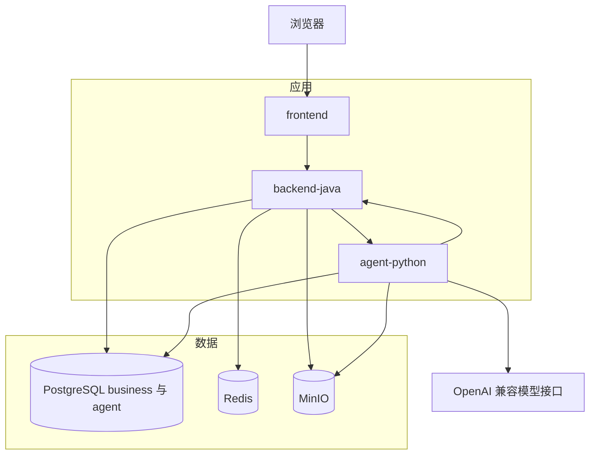
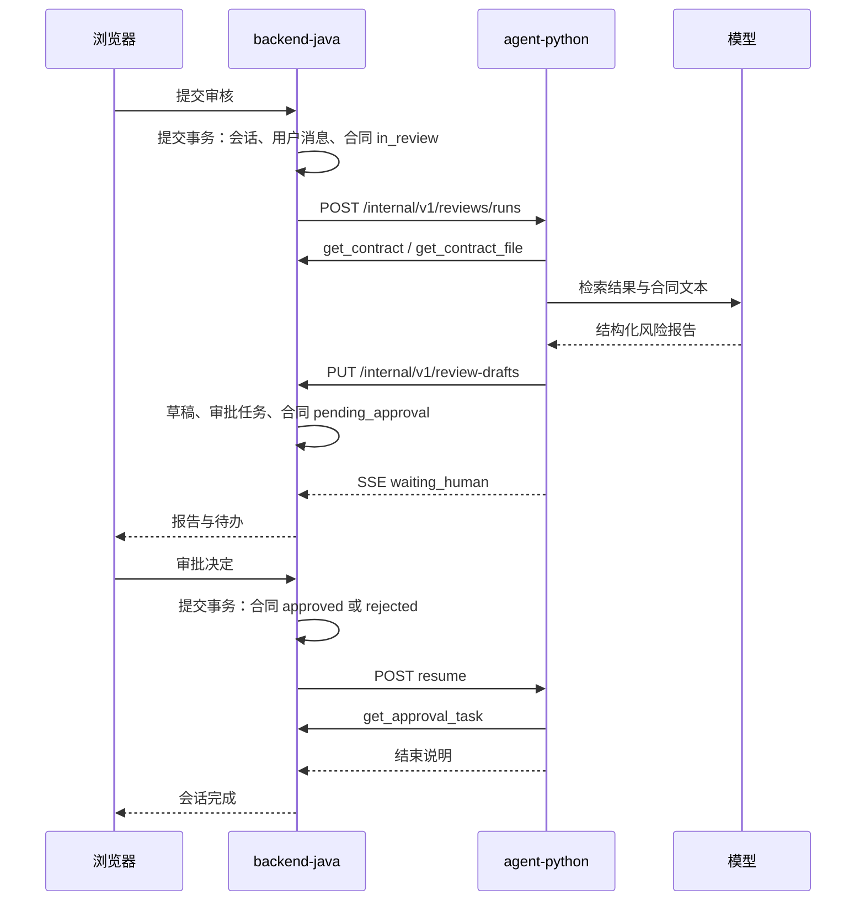
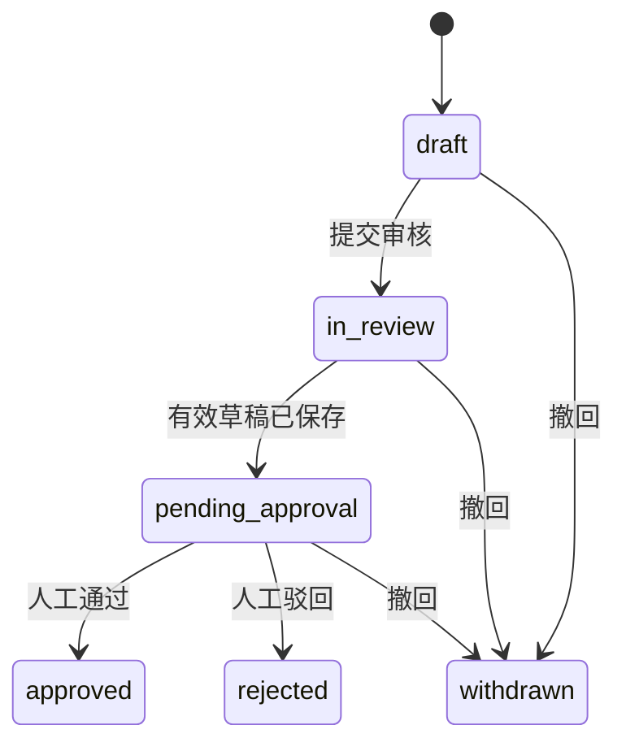
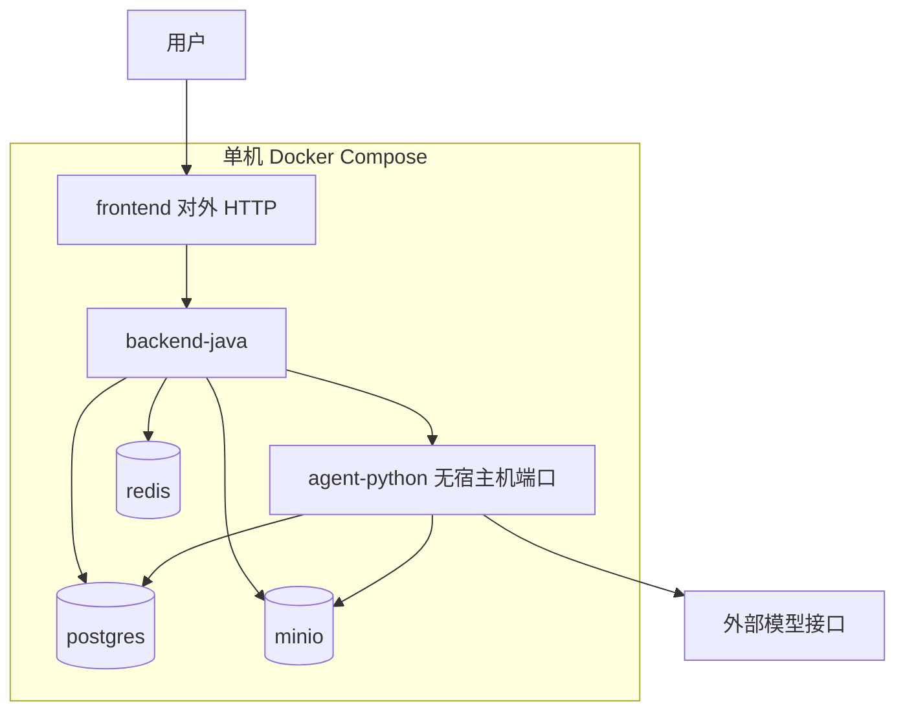

# Enterprise Agent 系统架构

本文是第一阶段架构基线。当前仓库里的业务代码大多仍是占位，实现以本文、[模块边界](./module-boundaries.md) 和 [数据库设计](../database/database-design.md) 为准。

## 1. 第一阶段范围

第一阶段只交付「企业合同智能审核与审批」：

- 租户内的用户、角色与权限
- 合同文件上传与登记
- 租户条款库（审核所依据的制度与范本）
- 基于检索增强的合同风险报告
- 单级人工审批，以及审批完成后的结果说明

第一阶段不做这些能力，也不为它们预留运行中的组件：

- 付款审核、通用知识问答等其他业务图（仓库中的 `payment_review`、`knowledge_qa` 不注册为运行入口）
- 多级审批、会签、转办
- 合同终态之后的再次审核
- 消息队列、独立向量数据库、Kubernetes、服务网格
- Prometheus、LangSmith 或其他独立可观测性后端
- Agent 自动把合同置为通过或驳回

风险等级只影响报告内容和审批页上的提示。低、中、高风险都进入人工审批。是否按风险跳过审批，待确认，默认不跳过。

## 2. 系统整体架构

系统由三个应用进程和三个基础设施进程组成。浏览器只到达前端和 Java。Python Agent 只在内部网络接受 Java 的调用。

| 进程 | 职责 |
| --- | --- |
| frontend | 登录、合同、审核对话、审批、条款库、用户管理界面 |
| backend-java | 身份、权限、租户、合同、审批、用户可见消息、业务审计；业务数据的唯一写入方 |
| agent-python | 合同审核图、文档解析、检索、模型调用、受控工具、执行记录、长期记忆 |
| PostgreSQL | 同一实例中的 `business`、`agent` 两个 schema；`agent` 使用 pgvector |
| Redis | 幂等响应缓存，以及 Java 在调用 Agent 前持有的会话运行锁 |
| MinIO | 合同与条款库原文件 |

Java 是业务事实的权威。合同状态、审批结论、用户可见对话都在 `business`。Python 不连接 `business` schema。它需要业务数据时调用 Java 内部接口，需要落业务结果时也只调用 Java。

LangGraph 的 checkpoint 只保存这一次图执行的短期状态。长期记忆是另一类数据，只保存已经确认、可复用的审核口径，不能代替合同或审批记录。

第一阶段部署在单机 Docker Compose 上。不设计多副本下的分布式事务。两个应用进程可以独立启动；对方不可用时，调用方返回明确错误。

### 2.1 不变式

以下六条在三份文档中保持同一含义：

1. 浏览器只访问 frontend 与 backend-java，不访问 agent-python，也不访问 MinIO。
2. `business` 由 Java 用 Flyway 迁移；`agent` 由 Python 迁移。跨 schema 只保存 UUID 逻辑引用，不建跨 schema 外键。
3. 合同状态与审批结论只由 Java 修改。Agent 没有「通过」或「驳回」工具。
4. 用户可见消息在 `business.chat_message`；图的短期状态在 LangGraph checkpoint；执行审计在 `agent` 运行表；长期记忆在 `agent.memory_item`，不能覆盖业务事实。
5. 多租户采用共享库、`business` / `agent` 两个 schema、`tenant_id`、请求上下文和 RLS。运行时数据库角色不能跨 schema 读写。
6. 第一阶段不自动通过合同，不引入消息队列、独立向量库和 Prometheus。

## 3. 技术栈及选型理由

### 3.1 前端

| 技术 | 理由 |
| --- | --- |
| React、TypeScript、Vite | 与仓库 `frontend/package.json` 一致，用于管理端单页应用 |
| Ant Design | 合同列表、审批表单、描述列表等后台界面 |
| Zustand | 保存登录态展示信息和界面状态。访问令牌只放内存 |
| TanStack Query | 服务端状态、重试和失效 |
| React Router | 已在依赖中，负责登录与业务页面路由 |
| axios | 已在依赖中，只请求 backend-java |
| react-markdown | 已在依赖中，渲染审核报告正文 |

`echarts` 已在依赖中。第一阶段架构不依赖图表服务，也不为图表增加后端聚合接口。

前端路由守卫只判断是否已登录。按钮是否可见可以参考登录接口返回的权限码，但真正的拒绝由 Java 返回 403。前端不实现一套并行的权限引擎。

### 3.2 Java 业务后端

| 技术 | 理由 |
| --- | --- |
| Java 21、Spring Boot 3 | 与 `backend-java/pom.xml` 的目标一致。小版本待确认 |
| Spring Security、JWT | 仓库已有 `JwtAuthenticationFilter` 与 `JwtTokenProvider` 的位置。浏览器使用 Bearer 访问令牌 |
| MyBatis-Plus | 租户、合同、审批等事务型 CRUD |
| Flyway | 只迁移 `business` schema |
| PostgreSQL | 业务库，与 Agent 共用实例、隔离 schema |

权限不写进 JWT。令牌只携带用户 ID 和租户 ID。`UserDetailsServiceImpl` 在每次请求时从数据库加载角色和权限，避免令牌里的权限过期。第一阶段不做权限缓存。

访问令牌建议有效期 8 小时，待确认。第一阶段不做刷新令牌。令牌不写入 `localStorage`。

### 3.3 Python Agent 后端

| 技术 | 理由 |
| --- | --- |
| Python 3.12、FastAPI、Pydantic | 与 `agent-python/pyproject.toml` 一致。内部 HTTP 接口和工具入参都用 Pydantic 校验 |
| LangChain | 模型调用、文档切分等组件的统一接口 |
| LangGraph | 审核图需要固定节点、可恢复的中断，以及人工决定之后的继续执行 |
| langgraph-checkpoint-postgres | 已在依赖中。checkpoint 写入 `agent` schema |
| httpx | 调用 Java 内部接口和 OpenAI 兼容模型接口 |
| psycopg | 访问 `agent` schema |

模型供应商待确认。第一阶段通过 OpenAI 兼容 HTTP 接口接入，不把某一家供应商 SDK 列为架构组件。仓库中的 `siliconflow.py` 只是兼容接口的一种实现位置。

嵌入模型名称和向量维度待确认。维度在建 `knowledge_chunk.embedding` 之前必须定下来，并在迁移里写成 `vector(N)`。

PDF、DOCX、纯文本的解析库待确认，实现落在已有的 `app/rag/loaders`，不单独起解析服务。

`app/observability/langsmith.py` 第一阶段不作为运行依赖。是否启用待确认。

### 3.4 基础设施

| 技术 | 第一阶段用法 |
| --- | --- |
| PostgreSQL + pgvector | 业务数据与向量检索放在同一实例，避免再运维一套向量库。建议主版本 16，镜像 tag 待确认 |
| Redis | 只做两件事：写接口的幂等响应缓存；Java 调用 Agent 期间的会话锁。Redis 里的数据都可以丢，丢了由数据库唯一约束兜底 |
| MinIO | 保存原文件。数据库只存对象键和校验信息 |
| Docker Compose | 本地与单机演示的唯一编排方式 |

幂等缓存保留 24 小时。过期后的重试仍由数据库唯一约束保证不重复写入；调用方可能收不到与第一次完全相同的快捷响应，但不会产生第二份审批任务或第二份草稿。

日志是第一阶段的可观测手段。每条日志包含 `service`、`trace_id`、`tenant_id`、`user_id`、`run_id`。日志中不写访问令牌、内部令牌、文件正文和完整模型提示词。

## 4. 服务之间的调用关系

```text
浏览器
  -> frontend
  -> backend-java
       -> PostgreSQL.business
       -> Redis
       -> MinIO
       -> agent-python
            -> PostgreSQL.agent
            -> MinIO（只读 Java 返回的对象键）
            -> 模型接口
            -> backend-java 内部工具接口
```

frontend 的开发服务器或静态资源服务只把 `/api` 代理到 backend-java。不配置到 agent-python 的代理。

### 4.1 浏览器到 Java

浏览器调用 `/api/v1`，请求头 `Authorization: Bearer <access_token>`。

第一阶段页面与主接口：

| 页面 | 接口 |
| --- | --- |
| 登录 | `POST /api/v1/auth/login`，`GET /api/v1/auth/me` |
| 合同列表与详情 | `GET/POST /api/v1/contracts`，`GET /api/v1/contracts/{id}` |
| 上传文件 | `POST /api/v1/contracts/{id}/files`，完成后 `POST /api/v1/contracts/{id}/files/{fileId}/complete` |
| 提交审核、查看对话 | `POST /api/v1/contracts/{id}/submit-review`，`GET /api/v1/sessions/{id}`，`GET /api/v1/sessions/{id}/events` |
| 审批 | `GET /api/v1/approval-tasks`，`POST /api/v1/approval-tasks/{id}/decision` |
| 条款库 | `POST /api/v1/policies` 及文件上传完成接口 |
| 用户与角色 | `/api/v1/users`、`/api/v1/roles`，仅租户管理员 |

`GET /api/v1/health` 不鉴权，只返回进程存活，不返回依赖详情。

文件二进制经 Java 转发到 MinIO。第一阶段不使用浏览器直传 MinIO 的预签名 URL。单文件大小上限待确认，建议 20MB。预签名上传作为后续优化，待确认。

### 4.2 Java 到 Python

Java 只在内部网络调用 agent-python 的 `/internal/v1`。

| 方法 | 路径 | 用途 |
| --- | --- | --- |
| POST | `/internal/v1/reviews/runs` | 启动一次审核运行。响应为 SSE |
| POST | `/internal/v1/reviews/runs/{run_id}/resume` | 人工决定已经写入后，恢复图并生成结束说明 |
| POST | `/internal/v1/knowledge/ingest` | 解析已登记的合同或条款库文件并写入向量 |
| GET | `/internal/v1/reviews/runs/{run_id}` | 查询运行状态，供 SSE 中断后的对账 |
| GET | `/internal/v1/health` | 存活检查 |

SSE 事件只有这几种：`run_started`、`message_delta`、`message_done`、`waiting_human`、`run_completed`、`run_failed`。Java 把事件转给浏览器。`message_delta` 只用于界面增量显示，不落库。`message_done` 的正文由 Java 写入 `chat_message`。

### 4.3 Python 到 Java

Python 的工具只调用下面的内部接口。模型不能指定 URL。

| 方法 | 路径 | 对应工具或调用方 |
| --- | --- | --- |
| GET | `/internal/v1/contracts/{contract_id}` | `get_contract` |
| GET | `/internal/v1/contracts/{contract_id}/files/{file_id}` | `get_contract_file`。响应给出对象键，供 Python 进程去 MinIO 读取 |
| GET | `/internal/v1/contracts` | `search_contracts`。查询条件里的租户以请求头为准 |
| PUT | `/internal/v1/review-drafts` | `save_review_draft`。以 `run_id` 幂等 |
| GET | `/internal/v1/approval-tasks/{task_id}` | `get_approval_task` |
| POST | `/internal/v1/agent-callbacks/run-status` | 图运行器同步会话状态。这不是模型可选工具，也不能修改审批结论 |

`PUT /internal/v1/review-drafts` 在校验通过后，于同一事务中：

1. 按 `run_id` 写入或更新审核草稿
2. 若该会话还没有 `pending` 审批任务，则创建任务
3. 把合同从 `in_review` 改为 `pending_approval`
4. 把会话改为 `waiting_human`

返回体包含 `approval_task_id`。Python 据此进入人工中断。请求里没有可以跳过审批的字段。

### 4.4 内部调用的公共规则

两个方向都带这些请求头：

| 请求头 | 含义 |
| --- | --- |
| `X-Internal-Token` | 服务间共享密钥 |
| `X-Tenant-Id` | 租户 |
| `X-User-Id` | 这次业务动作所代表的用户 |
| `X-Trace-Id` | 贯穿浏览器、Java、Python 的追踪号 |
| `X-Idempotency-Key` | 写请求必填 |
| `X-Run-Id` | 已有运行时必填 |

Python 不解析用户 JWT。它只接受带内部令牌的调用，并把用户、租户原样传回 Java。Java 在每个内部接口上重新检查这个用户是否属于该租户、是否拥有该资源权限。服务身份不能代替用户权限。

内部令牌放在两侧环境变量，不进入镜像、前端和日志。持有该令牌可以冒充租户内用户，因此 agent-python 不对宿主机公开端口。改用 mTLS 或请求签名的时间点待确认。

错误体统一为：

```json
{"code":"PERMISSION_DENIED","message":"无权读取该合同","trace_id":"..."}
```

`code` 只使用：`UNAUTHORIZED`、`PERMISSION_DENIED`、`TENANT_MISMATCH`、`NOT_FOUND`、`CONFLICT`、`VALIDATION_ERROR`、`IDEMPOTENCY_REPLAY`、`TOOL_FAILED`、`AGENT_FAILED`。

### 4.5 避免 Java 与 Python 互相死锁

一次审核的事务边界：

1. Java 先提交自己的事务：用户消息已写入，会话变为 `active`，运行锁已拿到。
2. Java 再打开到 Python 的 SSE。这条调用上不持有数据库事务。
3. Python 调用 Java 工具时，Java 为每次调用开启新的短事务。
4. SSE 结束后，Java 再用新事务写入助手消息。有效草稿保存时会话已经是 `waiting_human`，这条收尾事务不把会话改回 `active`。

禁止在未提交的事务里同步调用对方。Java 调用 Python 的线程，与 Java 处理 Python 工具回调的线程池分开。

读工具可以重试。写工具只允许携带同一个 `X-Idempotency-Key` 重试。超时后的重试先查运行状态，不直接再启动一条新图。

## 5. 核心业务数据流

### 5.1 角色

| 角色 | 权限 |
| --- | --- |
| `tenant_admin` | `tenant:manage`、`contract:read`、`contract:write`、`contract:submit`、`approval:decide`、`policy:manage` |
| `contract_manager` | `contract:read`、`contract:write`、`contract:submit` |
| `approver` | `contract:read`、`approval:decide` |

第一阶段一个用户只属于一个租户。`contract_manager` 可以处理本租户全部合同，合同上的 `owner_user_id` 用于审计。是否改为只能处理本人合同，待确认。

第一阶段审批不指定唯一处理人。同一租户内任何具备 `approval:decide` 的用户都可以处理待办。Java 用 `status = pending` 的条件更新保证只有一次决定生效。

### 5.2 合同状态

| 状态 | 进入条件 |
| --- | --- |
| `draft` | 创建合同 |
| `in_review` | 用户提交审核 |
| `pending_approval` | Java 接受了一份有效审核草稿 |
| `approved` | 审批人在界面上通过 |
| `rejected` | 审批人在界面上驳回 |
| `withdrawn` | 创建人或租户管理员在终态之前撤回 |

`approved`、`rejected`、`withdrawn` 在第一阶段是终态。Agent 运行失败时合同保持 `in_review`，会话变为 `failed`，用户用同一次会话重试。

### 5.3 上传与入库

1. 具备 `contract:write` 的用户创建 `draft` 合同并上传文件。
2. Java 把原文件写入 MinIO，对象键为 `{tenant_id}/contracts/{contract_id}/{file_id}`。条款库为 `{tenant_id}/policies/{policy_id}/{file_id}`。
3. Java 核对大小和校验和。通过后把 `contract_file.status`（或条款库文件状态）标为 `ready`，`index_status` 仍为 `not_indexed`，再同步调用 Python 入库接口。
4. Python 解析、切分、嵌入，写入 `knowledge_document` 与 `knowledge_chunk`。
5. Java 只根据这次 HTTP 结果更新业务表上的 `index_status`：成功为 `ready`，失败为 `failed`。Java 不读取 `agent` schema。提交审核要求当前文件 `status = ready` 且 `index_status = ready`；失败时由用户再次触发入库。

桶名使用 `enterprise-agent`。第一阶段 Java 与 Python 共用一对 MinIO 访问密钥。Python 只读取本次 Java 响应里的对象键，不提供列桶或列对象的工具。是否拆成两套密钥，待确认。

### 5.4 提交审核

1. 用户提交审核说明。Java 检查 `contract:submit`、合同状态，以及当前文件 `status = ready` 且 `index_status = ready`。
2. Java 在一个事务里把合同改为 `in_review`，创建或复用 `review_session`，写入用户消息，生成这一次运行的幂等键。
3. 同一合同只允许一个 `active` 或 `waiting_human` 会话，由数据库部分唯一索引保证。
4. Java 获取 Redis 锁 `lock:review-session:{tenant_id}:{session_id}`。拿不到锁则返回 `CONFLICT`。锁 TTL 为 15 分钟，调用结束的 `finally` 中释放。
5. 事务提交后，Java 调用 Python。LangGraph 的 `thread_id` 等于 `review_session.id`。
6. 图读取合同、检索切片和条款库、生成报告，再调用 `save_review_draft`。
7. Java 在保存草稿的同一事务里创建审批任务，把合同改为 `pending_approval`，把会话改为 `waiting_human`。图随后中断。
8. Java 把报告说明写入 `chat_message`，释放 Redis 锁。会话状态保持 `waiting_human`。

等待人工期间，Java 拒绝该会话上的新对话消息。补充意见写在审批意见里。

### 5.5 人工审批

1. 审批人调用决定接口。Java 检查 `approval:decide`，条件更新任务，把合同改为 `approved` 或 `rejected`，写 `audit_log`。
2. 该事务提交后，Java 拿同一把会话锁，再调用 Python 的 resume。调用结束的 `finally` 中释放。
3. Python 用 `get_approval_task` 读取已经落库的决定，生成结束说明。它不再次修改合同。
4. Java 把结束说明写入 `chat_message`，会话改为 `completed`。

如果 resume 失败，审批结论仍然有效。Java 将会话标为 `failed`，并允许用同一审批结果重新 resume。重新 resume 使用新的运行幂等键，但读取的是同一条已决定的审批任务。

### 5.6 长期记忆何时写入

第一阶段不在每次对话后自动抽取记忆。只有审批已经落库，并且 Java 在 resume 请求中显式带上「可以记住的口径」时，Python 才写 `memory_item`。

可以记住的内容是租户级审核口径，例如「该租户默认账期为 30 天」。记忆条目保存来源 `run_id`，不保存审批结论的副本。下一次审核可以把记忆放进提示词，但提示词中同时写明：与合同主数据和本次条款冲突时，以 Java 返回的合同数据和检索到的原文为准。

谁在界面上编辑或删除记忆，待确认。第一阶段可以不提供记忆管理页面。

## 6. Agent 工作流

第一阶段只注册一条图：合同审核。节点使用已有目录 `agent-python/app/graphs/nodes`。

| 顺序 | 节点 | 行为 |
| --- | --- | --- |
| 1 | `intent_node` | 确认本次输入是审核提交说明，整理用户关注点。不路由到其他业务 |
| 2 | `tool_node` | 调用 `get_contract`、`get_contract_file`。文件正文由工具实现拉取，不把对象键交给模型 |
| 3 | `rag_node` | 检索当前合同切片和本租户条款库。检索在服务内完成，不做成模型可乱调的检索工具 |
| 4 | `analysis_node` | 输出结构化发现：条款、风险等级、说明、建议、原文摘录、证据切片 ID |
| 5 | `tool_node` | 调用 `save_review_draft`。草稿校验失败则图失败，不改合同到待审批 |
| 6 | `human_review_node` | 收到 `approval_task_id` 后中断。恢复时只接受 Java 传入的任务 ID |
| 7 | `response_node` | 中断前生成给用户看的报告说明；恢复后根据 `get_approval_task` 的结果生成结束说明 |

模型可调用的工具只有：

| 工具 | 作用 | 权限 |
| --- | --- | --- |
| `get_contract` | 读取合同主数据 | 会话用户具备 `contract:read`，且合同属于该会话 |
| `get_contract_file` | 取得当前审核文件的文本 | 同上，且文件属于该合同 |
| `search_contracts` | 在本租户检索历史合同的主数据 | `contract:read` |
| `save_review_draft` | 保存非空风险报告 | 会话用户具备 `contract:submit`，`run_id` 匹配。首次保存时会话为 `active`；同一 `run_id` 重试时会话可以已是 `waiting_human`，只更新草稿 |
| `get_approval_task` | 读取审批任务 | 会话所属用户可读取本会话任务；具备 `approval:decide` 的用户也可读取 |

`approval_tools.py` 里第一阶段只保留读取。不注册决定审批的函数。`payment_tools.py`、`user_tools.py`、`knowledge_tools.py` 不进入模型工具列表。用户身份来自 Java 传入的上下文，不由模型查询后自行改写。

每一次工具调用在 `agent.tool_invocation` 记一条记录，幂等键为 `{run_id}:{tool_name}:{step}`。`save_review_draft` 的业务幂等键是 `run_id`：同一次运行重复保存只更新同一份草稿。

图运行的状态为 `running`、`waiting_human`、`completed`、`failed`、`cancelled`。进程在中断点之外崩溃时，用 checkpoint 和 `GET /internal/v1/reviews/runs/{run_id}` 恢复；Java 不靠读 checkpoint 判断业务是否已经审批。

## 7. 部署架构

Compose 项目名 `enterprise-agent`，服务名固定为：

- `frontend`
- `backend-java`
- `agent-python`
- `postgres`
- `redis`
- `minio`

`agent-python` 不映射宿主机端口。`postgres`、`redis`、`minio` 在 `docker-compose.dev.yml` 中映射到本机，便于开发；`docker-compose.yml` 只把 frontend 的 HTTP 端口暴露到宿主机。具体端口号待确认。MinIO 控制台不对公网开放。

PostgreSQL 使用 pgvector 镜像。初始化脚本 `database/postgres/init` 只创建扩展、schema 和角色，不建业务表。

运行时账号：

| 账号 | 使用者 |
| --- | --- |
| `business_migrator` | Flyway |
| `business_app` | backend-java 业务连接 |
| `agent_migrator` | Python 迁移和 LangGraph `setup()` |
| `agent_app` | agent-python 业务连接 |

`database/postgres/seed` 只给本地演示，不进入正式启动路径。

两个应用的 `depends_on` 只等待 PostgreSQL 健康，不互相等待，避免启动环。

## 8. 架构图

### 8.1 容器关系



### 8.2 审核主路径



### 8.3 合同状态



### 8.4 部署



## 9. 待确认

| 项 | 当前处理 |
| --- | --- |
| 模型供应商、嵌入模型、向量维度 | 接口按 OpenAI 兼容实现；维度未写入本文 |
| Java 与 Spring Boot 小版本、访问令牌小时数 | 建议 Java 21、Spring Boot 3、8 小时 |
| 刷新令牌 | 第一阶段不做 |
| 单文件大小上限 | 建议 20MB |
| 预签名直传 MinIO | 第一阶段不采用 |
| MinIO 是否拆分 Java/Python 密钥 | 第一阶段共用一对密钥 |
| 内部认证升级为 mTLS 或签名 | 第一阶段用共享密钥 |
| 低风险跳过审批、多级审批、终态后再次审核 | 默认都不做 |
| 合同是否仅本人可见 | 默认合同经理可见本租户全部合同 |
| 长期记忆的管理界面，以及记忆是否向量化 | 第一阶段用结构化表，无向量列，无管理页 |
| 原文摘录的字数上限 | 建议单条 500 字 |
| 向量索引用 HNSW 还是 IVFFlat | 维度和数据量确定后再建索引 |
| Compose 宿主机端口、PostgreSQL 镜像 tag | 实施时写进 compose |
| 解析 PDF/DOCX 的具体库 | 落在现有 loader，库未选定 |
| LangSmith | 默认关闭 |

## 10. 与其他文档的对齐

模块职责、工具名单、内部路径和请求头以 [模块边界](./module-boundaries.md) 为准，并与本文第 4、6 节一致。表、状态枚举、RLS 和迁移职责以 [数据库设计](../database/database-design.md) 为准，并与本文第 2.1、5、7 节一致。
