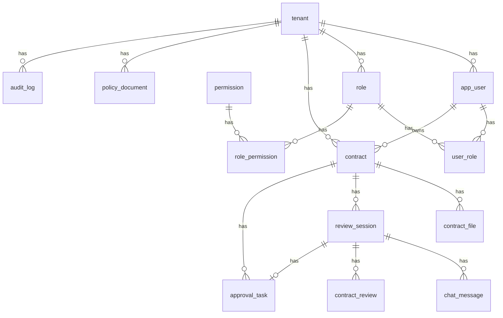

# Enterprise Agent 数据库设计

本文定义第一阶段 PostgreSQL 的 schema、表、隔离和迁移。进程职责见 [系统架构](../architecture/system-architecture.md) 与 [模块边界](../architecture/module-boundaries.md)。

数据库脚本在实现到迁移时再提交。`database/postgres/init` 只创建扩展、schema 和角色，不建业务表，也不提前提交空脚本。

## 1. 不变式

1. 浏览器只访问 frontend 与 backend-java，不访问 agent-python，也不访问 MinIO。
2. `business` 由 Java 用 Flyway 迁移；`agent` 由 Python 迁移。跨 schema 只保存 UUID 逻辑引用，不建跨 schema 外键。
3. 合同状态与审批结论只由 Java 修改。Agent 没有「通过」或「驳回」工具。
4. 用户可见消息在 `business.chat_message`；图的短期状态在 LangGraph checkpoint；执行审计在 `agent` 运行表；长期记忆在 `agent.memory_item`，不能覆盖业务事实。
5. 多租户采用共享库、`business` / `agent` 两个 schema、`tenant_id`、请求上下文和 RLS。运行时数据库角色不能跨 schema 读写。
6. 第一阶段不自动通过合同，不引入消息队列、独立向量库和 Prometheus。

## 2. Schema 划分

同一个 PostgreSQL 实例，两个 schema：

| Schema | 所有者 | 运行时角色 | 内容 |
| --- | --- | --- | --- |
| `business` | `business_migrator` | `business_app` | 租户、身份、合同、文件登记、会话消息、审批、业务审计 |
| `agent` | `agent_migrator` | `agent_app` | 知识切片、长期记忆、运行记录、LangGraph checkpoint |

扩展 `vector` 装在数据库级，供 `agent` 使用。镜像是 `pgvector/pgvector:0.8.7-pg16`。

不使用 `public` 存放应用表。Java 连接的 `search_path` 只有 `business`。Python 连接的 `search_path` 只有 `agent`。

初始化脚本 `database/postgres/init` 的职责止于：

1. `CREATE EXTENSION IF NOT EXISTS vector`
2. 创建 schema `business`、`agent`
3. 创建四个角色，并授予 schema 使用权限
4. 启用默认权限，使后续 Flyway 和 Python 迁移创建的表自动只对对应 app 角色开放 DML

四个角色都不作为超级用户运行应用。`business_app` 不能 `USAGE` `agent`。`agent_app` 不能 `USAGE` `business`。

## 3. business 与 agent 的数据归属

| 数据 | 归属 | 说明 |
| --- | --- | --- |
| 租户、用户、角色、权限 | business | 身份主数据 |
| 合同、合同文件元数据、条款库文件元数据 | business | 原文件字节在 MinIO |
| 审核会话、用户可见消息 | business | 前端只向 Java 读取 |
| 审核草稿、审批任务、业务审计 | business | 合同状态以 `contract.status` 为准 |
| 知识文档与切片、向量 | agent | 由入库接口写入 |
| 运行、步骤、工具调用 | agent | 排障与幂等，不作为审批依据 |
| checkpoint | agent | LangGraph 短期状态 |
| 长期记忆 | agent | 可复用口径，不是业务事实 |
| 幂等快捷响应、会话运行锁 | Redis | 可丢失。防重复以数据库唯一约束为准 |

跨 schema 引用使用 UUID，不建跨 schema 外键。schema 内部可以建外键。允许出现的跨 schema 引用：

| 来源 | 字段 | 指向 |
| --- | --- | --- |
| `agent.agent_run.session_id` | UUID | `business.review_session.id` |
| `agent.knowledge_document.source_id` | UUID | `business.contract_file.id` 或 `business.policy_document.id` |
| `business.contract_review.run_id` | UUID | `agent.agent_run.id` |
| `business.review_session.active_run_id` | UUID | `agent.agent_run.id` |
| `agent.memory_item.source_run_id` | UUID | `agent.agent_run.id` |
| 草稿 `findings.evidence` | UUID 数组 | `agent.knowledge_chunk.id` |

对账使用 `trace_id`。不做跨 schema 的同步复制表。

对象键不作为数据库之间的关联，但业务表保存对象键以便 Java 取文件：

- `{tenant_id}/contracts/{contract_id}/{file_id}`
- `{tenant_id}/policies/{policy_id}/{file_id}`

桶名 `enterprise-agent`。

## 4. 公共约定

- 主键均为 UUID，由应用生成后插入。
- 业务表都有 `tenant_id UUID NOT NULL`、`created_at`、`updated_at`。`audit_log` 与 `chat_message` 不更新，无 `updated_at`。
- 时间使用 `timestamptz`。
- 枚举用 `text` 加检查约束，不用数据库枚举类型，以便 Flyway 后续扩展取值。
- 删除第一阶段采用状态位或业务状态，不做物理级联删除。条款库文件是否支持物理删除，待确认。

## 5. 核心业务实体



一个用户第一阶段只属于一个租户，所以用户表上直接有 `tenant_id`，不建用户-租户关联表。

### 5.1 身份

`tenant`

| 列 | 约束 |
| --- | --- |
| `id` | 主键 |
| `code` | 非空，全局唯一 |
| `name` | 非空 |
| `status` | `active` 或 `disabled` |
| `created_at`、`updated_at` | 非空 |

`app_user`

| 列 | 约束 |
| --- | --- |
| `id` | 主键 |
| `tenant_id` | 非空 |
| `login_name` | 租户内唯一 |
| `password_hash` | 非空 |
| `display_name` | 非空 |
| `status` | `active` 或 `disabled` |
| `created_at`、`updated_at` | 非空 |

唯一约束：`(tenant_id, login_name)`。

`role`

| 列 | 约束 |
| --- | --- |
| `id` | 主键 |
| `tenant_id` | 非空 |
| `code` | `tenant_admin`、`contract_manager`、`approver` |
| `name` | 非空 |
| `created_at`、`updated_at` | 非空 |

唯一约束：`(tenant_id, code)`。第一阶段不提供自定义角色。是否开放自定义角色，待确认。

`permission` 是全局码表，没有 `tenant_id`，也不启用租户 RLS。初始行：

| code | 说明 |
| --- | --- |
| `tenant:manage` | 用户与角色 |
| `contract:read` | 读合同与会话 |
| `contract:write` | 建合同、上传、撤回 |
| `contract:submit` | 提交审核并允许保存草稿 |
| `approval:decide` | 通过或驳回 |
| `policy:manage` | 条款库 |

`role_permission` 与 `user_role` 都带 `tenant_id`，并参与 RLS。联合主键分别是 `(role_id, permission_id)`、`(user_id, role_id)`。`tenant_id` 必须与对应 `role`、`app_user` 的租户相同。

初始授权与架构文档一致：

| 角色 | 权限 |
| --- | --- |
| `tenant_admin` | 全部六项 |
| `contract_manager` | `contract:read`、`contract:write`、`contract:submit` |
| `approver` | `contract:read`、`approval:decide` |

### 5.2 合同与文件

`contract`

| 列 | 约束 |
| --- | --- |
| `id` | 主键 |
| `tenant_id` | 非空 |
| `contract_no` | 租户内唯一 |
| `title` | 非空 |
| `counterparty_name` | 非空 |
| `status` | `draft`、`in_review`、`pending_approval`、`approved`、`rejected`、`withdrawn` |
| `owner_user_id` | 创建人 |
| `current_file_id` | 可空，指向本表同一租户下的 `contract_file` |
| `created_at`、`updated_at` | 非空 |

唯一约束：`(tenant_id, contract_no)`。索引：`(tenant_id, status)`。

`contract_file.contract_id` 建指向 `contract` 的外键。`current_file_id` 不建外键，避免和 `contract_file.contract_id` 形成环；应用保证它指向同一合同、同一租户的文件。

状态只按下面的方向变化：

| 从 | 到 | 原因 |
| --- | --- | --- |
| `draft` | `in_review` | 提交审核 |
| `draft` | `withdrawn` | 撤回 |
| `in_review` | `pending_approval` | 有效审核草稿保存成功 |
| `in_review` | `withdrawn` | 撤回 |
| `pending_approval` | `approved` | 人工通过 |
| `pending_approval` | `rejected` | 人工驳回 |
| `pending_approval` | `withdrawn` | 撤回 |

`approved`、`rejected`、`withdrawn` 不再迁出。Agent 失败不增加合同状态，合同留在 `in_review`。

`contract_file`

| 列 | 约束 |
| --- | --- |
| `id` | 主键 |
| `tenant_id` | 非空 |
| `contract_id` | 非空 |
| `version_no` | 从 1 递增 |
| `object_key` | 非空 |
| `filename` | 非空 |
| `media_type` | 非空 |
| `byte_size` | 非空 |
| `checksum_sha256` | 非空 |
| `status` | `pending`、`ready`、`failed`。表示字节是否已写入 MinIO 并通过校验 |
| `index_status` | `not_indexed`、`ready`、`failed`。表示 Java 是否收到入库成功响应 |
| `uploaded_by` | 非空 |
| `created_at`、`updated_at` | 非空 |

唯一约束：`(contract_id, version_no)`、`(tenant_id, object_key)`。只有 `draft` 合同可以增加新版本。提交审核时冻结 `current_file_id`，并要求 `status = ready` 且 `index_status = ready`。

`policy_document`

| 列 | 约束 |
| --- | --- |
| `id` | 主键 |
| `tenant_id` | 非空 |
| `title` | 非空 |
| `object_key` | 租户内唯一 |
| `filename` | 非空 |
| `media_type` | 非空 |
| `byte_size` | 非空 |
| `checksum_sha256` | 非空 |
| `status` | `pending`、`ready`、`failed`。表示字节是否已写入 MinIO 并通过校验 |
| `index_status` | `not_indexed`、`ready`、`failed` |
| `uploaded_by` | 非空 |
| `created_at`、`updated_at` | 非空 |

文件字节不进入 `contract_file` 和 `policy_document`。大小上限是 20MB，由 Java 在写入前拒绝。`index_status` 由 Java 按入库 HTTP 结果更新。切片内容仍只在 `agent.knowledge_chunk`。

`stored_file` 是通用文件登记。桶名仍是 `enterprise-agent`。对象键由服务端生成，形式为 `{tenant_id}/files/{yyyy}/{MM}/{file_id}.{ext}`，不使用客户端文件名。状态为 `ready`、`deleted` 或 `failed`。表启用与身份表相同的租户 RLS。

Day 13 已创建 `business.contract` 和 `business.contract_file`。合同名称列是 `title`。状态使用业务生命周期 `draft`、`pending_review`、`approved`、`rejected`、`effective`、`expired`、`terminated`，不使用上面与 Agent 审核绑定的状态。`contract_file` 只引用 `stored_file`，并记录 `file_role`，不保存对象键或文件字节。

Day 14 增加 `business.contract_version`。版本号由服务端从 1 递增，展示标签为 `V1`、`V2`。同一合同用部分唯一索引保证最多一条 `is_current`。版本只引用 `stored_file`，不把同一文件再写入 `contract_file`。只有 `draft` 和 `rejected` 可以创建新版本。没有版本回滚，也不把历史版本直接改回当前版本。上面的审核会话和带对象键的文件版本仍留到后续审核工作流。

### 5.3 会话、草稿与审批

`review_session`

| 列 | 约束 |
| --- | --- |
| `id` | 主键。同时作为 LangGraph `thread_id`，不另存一列 |
| `tenant_id` | 非空 |
| `contract_id` | 非空 |
| `user_id` | 提交人 |
| `status` | `active`、`waiting_human`、`completed`、`failed`、`cancelled` |
| `active_run_id` | 可空，逻辑引用 |
| `idempotency_key` | 可空，当前或最近一次启动运行的幂等键 |
| `created_at`、`updated_at` | 非空 |

部分唯一索引：`(tenant_id, contract_id)`，条件为 `status in ('active', 'waiting_human')`。因此一个合同同时只有一个未结束会话。

会话在提交审核时变为 `active`。`PUT /internal/v1/review-drafts` 保存有效草稿的同一事务里变为 `waiting_human`。同一 `run_id` 的重试在会话已经是 `waiting_human` 时只更新草稿。审批任务仍是 `pending` 时，运行状态回调不能把会话改回 `active` 或 `failed`。审批已经决定后，resume 成功变为 `completed`，resume 失败变为 `failed`；合同状态保持已决定的结果。草稿保存前的运行失败变为 `failed`。

`chat_message`

| 列 | 约束 |
| --- | --- |
| `id` | 主键 |
| `tenant_id` | 非空 |
| `session_id` | 非空 |
| `role` | `user` 或 `assistant` |
| `content` | 非空 |
| `client_message_id` | 用户消息必填，助手消息为空 |
| `source_run_id` | 助手消息填写，用户消息为空 |
| `created_at` | 非空 |

唯一约束：`(tenant_id, session_id, client_message_id)`，仅当 `client_message_id` 非空。索引：`(session_id, created_at)`。

这里不存 `tool` 角色，也不存模型中间推理。

`contract_review`

| 列 | 约束 |
| --- | --- |
| `id` | 主键 |
| `tenant_id` | 非空 |
| `contract_id` | 非空 |
| `session_id` | 非空 |
| `run_id` | 非空，逻辑引用 |
| `risk_level` | `low`、`medium`、`high` |
| `summary` | 非空 |
| `findings` | `jsonb`，非空数组 |
| `status` | `draft` 或 `superseded` |
| `created_at`、`updated_at` | 非空 |

唯一约束：`(tenant_id, run_id)`。同一会话新的成功运行把上一份 `draft` 改为 `superseded`。

`findings` 的元素形状：

```json
{
  "clause": "付款",
  "level": "high",
  "description": "账期长于条款库要求",
  "suggestion": "改为 30 天",
  "excerpt": "甲方应于验收后 90 日内付款",
  "evidence": ["知识切片 UUID"]
}
```

`excerpt` 建议不超过 500 字，待确认。Java 校验 `risk_level` 与 `findings` 非空；不合格则整次保存失败，不创建审批任务，不改合同状态。

风险等级不决定是否审批。每一份合格草稿都会进入待审批。

`approval_task`

| 列 | 约束 |
| --- | --- |
| `id` | 主键 |
| `tenant_id` | 非空 |
| `contract_id` | 非空 |
| `session_id` | 非空 |
| `review_id` | 非空，指向 `contract_review` |
| `status` | `pending`、`approved`、`rejected`、`cancelled` |
| `decision_comment` | 可空 |
| `decided_by` | 可空 |
| `decided_at` | 可空 |
| `created_at`、`updated_at` | 非空 |

部分唯一索引：`(tenant_id, session_id)`，条件为 `status = 'pending'`。

决定更新必须带条件 `status = 'pending'` 且合同状态为 `pending_approval`。更新行数为 0 则返回 `CONFLICT`。第一阶段不指定唯一审批人，同一租户内具备 `approval:decide` 的用户都可以处理。

撤回合同时，若存在 `pending` 任务，则把任务改为 `cancelled`。

`audit_log`

| 列 | 约束 |
| --- | --- |
| `id` | 主键 |
| `tenant_id` | 非空 |
| `actor_user_id` | 非空 |
| `action` | 见下表 |
| `resource_type` | 非空 |
| `resource_id` | 非空 |
| `trace_id` | 非空 |
| `detail` | `jsonb` |
| `created_at` | 非空 |

`action` 第一阶段限于：`contract.create`、`file.upload`、`review.submit`、`review.draft_saved`、`approval.decide`、`contract.withdraw`。

`detail` 不放文件正文。索引：`(tenant_id, created_at)`。

不把 `agent_step` 复制进 `audit_log`。业务审计和 Agent 执行记录通过 `trace_id` 关联。

## 6. Agent 执行记录

`agent_run`

| 列 | 约束 |
| --- | --- |
| `id` | 主键 |
| `tenant_id` | 非空 |
| `session_id` | 非空，逻辑引用 `review_session.id` |
| `graph_name` | 第一阶段固定为 `contract_review` |
| `status` | `running`、`waiting_human`、`completed`、`failed`、`cancelled` |
| `idempotency_key` | 非空 |
| `trace_id` | 非空 |
| `error_code` | 可空 |
| `started_at`、`finished_at` | `finished_at` 可空 |

唯一约束：`(tenant_id, idempotency_key)`。索引：`(tenant_id, session_id, started_at)`。

同一次启动请求重试命中同一 `idempotency_key`，返回已有 `agent_run`。用户在失败后主动重试时，Java 生成新的幂等键和新运行。checkpoint 仍用原来的 `review_session.id` 作为 `thread_id`。

`agent_step`

| 列 | 约束 |
| --- | --- |
| `id` | 主键 |
| `tenant_id` | 非空 |
| `run_id` | 非空 |
| `node_name` | `intent_node`、`rag_node`、`analysis_node`、`tool_node`、`human_review_node`、`response_node` |
| `status` | `running`、`succeeded`、`failed` |
| `error_code` | 可空 |
| `started_at`、`finished_at` | `finished_at` 可空 |

不保存完整提示词和模型原文。需要回放某一步时，以 checkpoint 为准，而不是以本表为准。

`tool_invocation`

| 列 | 约束 |
| --- | --- |
| `id` | 主键 |
| `tenant_id` | 非空 |
| `run_id` | 非空 |
| `step_id` | 非空 |
| `tool_name` | 白名单中的名字 |
| `idempotency_key` | 非空，格式 `{run_id}:{tool_name}:{step}` |
| `status` | `running`、`succeeded`、`failed` |
| `error_code` | 可空 |
| `started_at`、`finished_at` | `finished_at` 可空 |

唯一约束：`(tenant_id, idempotency_key)`。

`tool_name` 只允许 `get_contract`、`get_contract_file`、`search_contracts`、`save_review_draft`、`get_approval_task`。

本表不保存工具返回的合同正文。对象键也不写入本表。

### 6.1 Checkpoint

checkpoint 表由 `langgraph-checkpoint-postgres` 的 `PostgresSaver.setup()` 在 `agent` schema 创建。表名和列以该库 2.x 的实际结果为准，本文不冻结其 DDL。

应用约定：

- `thread_id` 等于 `business.review_session.id`
- 只在迁移阶段用 `agent_migrator` 执行 `setup()`
- `agent_app` 在运行时读写这些表
- Java 不连接这些表
- 审批是否完成只看 `business.approval_task` 与 `contract.status`

等待人工时，图停在 checkpoint。会话状态 `waiting_human` 是给界面用的业务投影，不是 checkpoint 的复制件。

## 7. 会话、消息、Checkpoint、长期记忆

| 概念 | 位置 | 生命周期 | 谁写入 | 用来做什么 |
| --- | --- | --- | --- | --- |
| 审核会话 `review_session` | business | 从提交审核到完成、失败或取消 | Java | 一条合同审核的业务容器，也是 LangGraph 线程 ID |
| 用户可见消息 `chat_message` | business | 与会话相同 | Java | 界面上的用户说明、报告说明、审批后的结束说明 |
| checkpoint | agent，库管表 | 与线程相同，进程崩溃后可恢复 | LangGraph | 节点中间状态、模型上下文、中断点 |
| 执行记录 `agent_run` / `agent_step` / `tool_invocation` | agent | 按次运行保留 | Python | 幂等、排障、和业务审计用 `trace_id` 对账 |
| 长期记忆 `memory_item` | agent | 跨会话保留，直到被明确删除 | Python，且仅当 Java 在 resume 时允许 | 租户审核口径，供下一次提示词参考 |

一次正常审批在 `chat_message` 里留下三条：提交时的用户消息、中断前的报告说明、恢复后的结束说明。token 增量不入库。

`waiting_human` 期间不插入新的用户消息。

`memory_item`

| 列 | 约束 |
| --- | --- |
| `id` | 主键 |
| `tenant_id` | 非空 |
| `scope` | 第一阶段只有 `tenant` |
| `content` | 非空 |
| `source_run_id` | 非空 |
| `created_at` | 非空 |

第一阶段没有 `user_id`，也没有 `embedding`。记忆是否按用户区分、是否向量化，待确认。

写入条件同时满足才插入：

1. 对应审批任务已经是 `approved` 或 `rejected`
2. Java 的 resume 请求明确允许写入记忆
3. 内容是口径短句，不是合同正文，也不是审批结论的复制

读取记忆时必须带当前 `tenant_id`。记忆与合同主数据或检索摘录冲突时，提示词要求模型采用后者。记忆不参与权限判断。

### 7.1 知识库表

`knowledge_document`

| 列 | 约束 |
| --- | --- |
| `id` | 主键 |
| `tenant_id` | 非空 |
| `source_type` | `contract_file` 或 `policy` |
| `source_id` | 非空，逻辑引用 |
| `content_hash` | 非空 |
| `status` | `pending`、`ready`、`failed` |
| `error_code` | 可空 |
| `created_at`、`updated_at` | 非空 |

唯一约束：`(tenant_id, source_type, source_id, content_hash)`。同一文件内容重复入库时复用该行。

`knowledge_chunk`

| 列 | 约束 |
| --- | --- |
| `id` | 主键 |
| `tenant_id` | 非空 |
| `document_id` | 非空 |
| `chunk_index` | 从 0 递增 |
| `content` | 非空 |
| `embedding` | `vector(N)`，N 待确认 |
| `created_at` | 非空 |

唯一约束：`(document_id, chunk_index)`。索引：`(tenant_id, document_id)`。

向量索引在 N 确定之后再建，类型在 HNSW 与 IVFFlat 之间选择，待确认。检索条件必须包含 `tenant_id`。合同审核还要能限制到当前文件对应的 `knowledge_document`，以及本租户 `source_type = policy` 的文档。

Java 不查询 `knowledge_document`。文件上传校验通过后，Java 同步调用 `POST /internal/v1/knowledge/ingest`，再把 `contract_file.index_status` 或 `policy_document.index_status` 写成 `ready` 或 `failed`。提交审核只读这个业务列。Python 侧同一 `content_hash` 的重复入库复用已有知识文档。两侧状态短暂不一致时，以重新调用入库接口后的 HTTP 结果为准，不建跨 schema 外键。

## 8. 多租户隔离

第一阶段是共享库、共享 schema、行级隔离。一个用户只属于一个租户。

每一张含 `tenant_id` 的表启用并强制 RLS。`permission` 没有 `tenant_id`，不加租户策略。checkpoint 表若包含可区分租户的元数据，仍必须在应用层使用带租户的 `thread_id`；线程 ID 本身是会话 UUID，会话属于单一租户。checkpoint 库表的 RLS 若与该库的写入方式冲突，则靠 `agent_app` 没有其他入口、以及线程 ID 只能由 Java 传入的会话创建来约束。不在本文假定可以修改库内部 SQL。应用自己的 `agent_run`、`knowledge_*`、`memory_item` 必须启用 RLS。

策略使用失败关闭：

```sql
ALTER TABLE business.contract ENABLE ROW LEVEL SECURITY;
ALTER TABLE business.contract FORCE ROW LEVEL SECURITY;

CREATE POLICY tenant_isolation ON business.contract
USING (
  tenant_id = NULLIF(current_setting('app.tenant_id', true), '')::uuid
)
WITH CHECK (
  tenant_id = NULLIF(current_setting('app.tenant_id', true), '')::uuid
);
```

`business` 与 `agent` 中所有带 `tenant_id` 的应用表都使用同名策略 `tenant_isolation`。`current_setting` 未设置时，比较结果为空，行不可见，也不可插入。

Java 和 Python 在取出连接后、执行业务 SQL 前设置：

```sql
SELECT set_config('app.tenant_id', :tenant_id, true);
```

第三个参数 `true` 表示只在当前事务有效。租户来自已经校验过的用户或内部请求头，不来自模型参数。

迁移角色是表所有者。所有者默认绕过 RLS，因此迁移角色不用于处理用户请求。运行时角色不是所有者，并且表使用 `FORCE ROW LEVEL SECURITY`。

跨租户访问在接口上返回 `NOT_FOUND`。RLS 则让错误的租户设置读不到行。两层都要保留。

种子数据 `database/postgres/seed` 可以插入演示租户，只在本地手动执行，不由 Compose 正式启动流程执行。

## 9. 迁移管理

| 顺序 | 执行者 | 位置 | 做什么 |
| --- | --- | --- | --- |
| 1 | PostgreSQL 首次初始化 | `database/postgres/init` | 扩展、schema、角色、默认权限 |
| 2 | backend-java 启动 | `backend-java/src/main/resources/db/migration` | Flyway 迁移 `business` |
| 3 | agent-python 启动 | `agent-python/migrations/{version}_{name}.sql` | 按 `agent.schema_migrations` 执行尚未应用的脚本，然后 `PostgresSaver.setup()` |

`agent.schema_migrations`：

| 列 | 约束 |
| --- | --- |
| `version` | 主键，例如 `001` |
| `name` | 非空 |
| `applied_at` | 非空 |

该表没有 `tenant_id`，由 `agent_migrator` 写入。Python 不引入 Alembic。脚本按版本号排序，在一个事务内执行并插入版本行。已存在的版本跳过。

Flyway 历史表放在 `business` schema，不使用默认的 `public`。

两个应用的迁移互不读取对方 schema，因此 Compose 不让 Java 和 Python 互相 `depends_on`。它们都只等待数据库健康检查通过。

初始化脚本禁止创建 `contract`、`agent_run` 等业务表，避免和迁移形成两套来源。

角色与权限的初始数据放在 Flyway 的可重复执行语句中：权限码六行，以及创建租户时需要的角色模板。创建租户的应用服务负责为该租户插入三种 `role` 及 `role_permission`。本文不把演示用户写进 Flyway。

## 10. 索引与完整性小结

除主键外，第一阶段至少建立这些约束：

| 约束 | 目的 |
| --- | --- |
| `app_user (tenant_id, login_name)` 唯一 | 登录名 |
| `role (tenant_id, code)` 唯一 | 内置角色不重复 |
| `contract (tenant_id, contract_no)` 唯一 | 合同编号 |
| `contract_file (contract_id, version_no)` 唯一 | 版本 |
| `contract_file (tenant_id, object_key)` 唯一 | 对象键 |
| `review_session (tenant_id, contract_id)` 部分唯一，活动或等待人工 | 一个合同一条进行中的审核 |
| `chat_message (tenant_id, session_id, client_message_id)` 部分唯一 | 用户消息重试 |
| `contract_review (tenant_id, run_id)` 唯一 | 一次运行一份草稿 |
| `approval_task (tenant_id, session_id)` 部分唯一，`pending` | 不会产生两张待办 |
| `agent_run (tenant_id, idempotency_key)` 唯一 | 启动运行重试 |
| `tool_invocation (tenant_id, idempotency_key)` 唯一 | 工具重试 |
| `knowledge_document (tenant_id, source_type, source_id, content_hash)` 唯一 | 重复入库 |
| `knowledge_chunk (document_id, chunk_index)` 唯一 | 切片顺序 |

Redis 键不替代上表：

| 键 | 持有者 | 作用 |
| --- | --- | --- |
| `lock:review-session:{tenant_id}:{session_id}` | 只有 Java | 启动运行和 resume 期间的互斥。TTL 15 分钟，`finally` 中释放 |
| `idem:java:{tenant_id}:{idempotency_key}` | Java | 24 小时内的写响应缓存 |
| `idem:agent:{tenant_id}:{idempotency_key}` | Python | 24 小时内的写响应缓存 |

锁获取失败返回 `CONFLICT`，不绕过锁继续启动图。

## 11. 待确认

| 项 | 当前处理 |
| --- | --- |
| 向量维度 N 与索引类型 | 列类型留到选定嵌入模型后写入迁移 |
| 嵌入模型与聊天模型供应商 | 不在数据库中保存供应商密钥；密钥只在环境变量 |
| 摘录长度 | 建议 500 字，由 Java 校验 |
| 文件大小 | 建议 20MB，不作为表约束，由应用拒绝 |
| 自定义角色、部门、一名用户多个租户 | 第一阶段不做 |
| 终态合同再次审核 | 第一阶段状态机不允许 |
| 记忆按用户隔离或向量化 | 表结构只有租户级文本 |
| 条款库物理删除 | 第一阶段可以只停用，待确认 |
| 审计与运行记录保留期限 | 未定期清理 |
| PostgreSQL 小版本与 pgvector 镜像 tag | 已使用 `pgvector/pgvector:0.8.7-pg16` |

## 12. 与其他文档的对齐

本文的状态枚举、工具名、对象键、Redis 键、`thread_id = review_session.id`、草稿保存时创建审批任务，与 [系统架构](../architecture/system-architecture.md) 和 [模块边界](../architecture/module-boundaries.md) 使用同一套规则。若实现代码与本文冲突，在修改代码前先改这三份文档中相应的同一条款。
